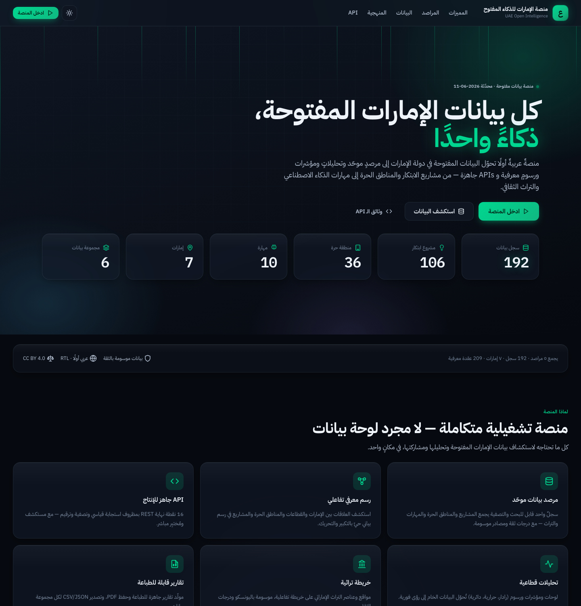
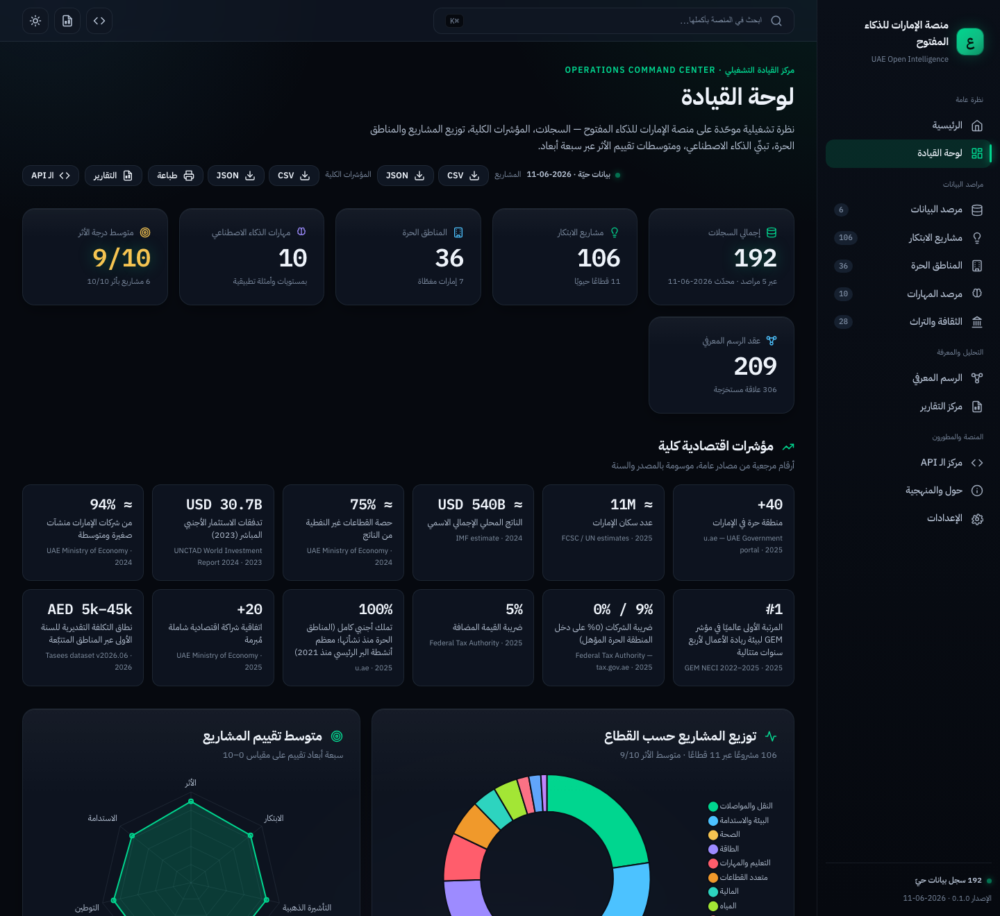
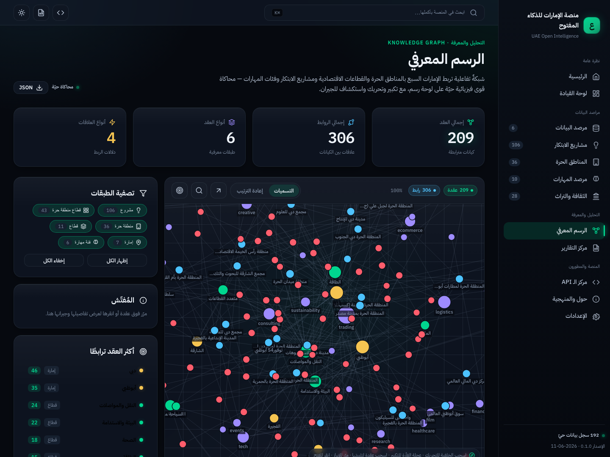
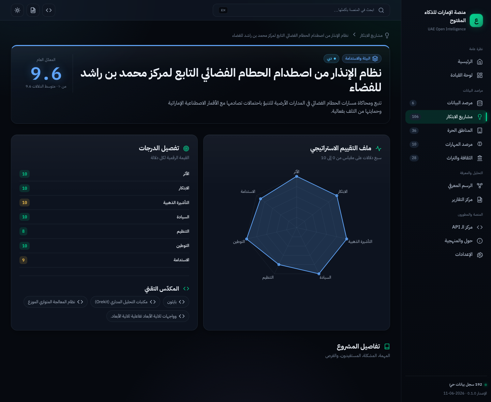
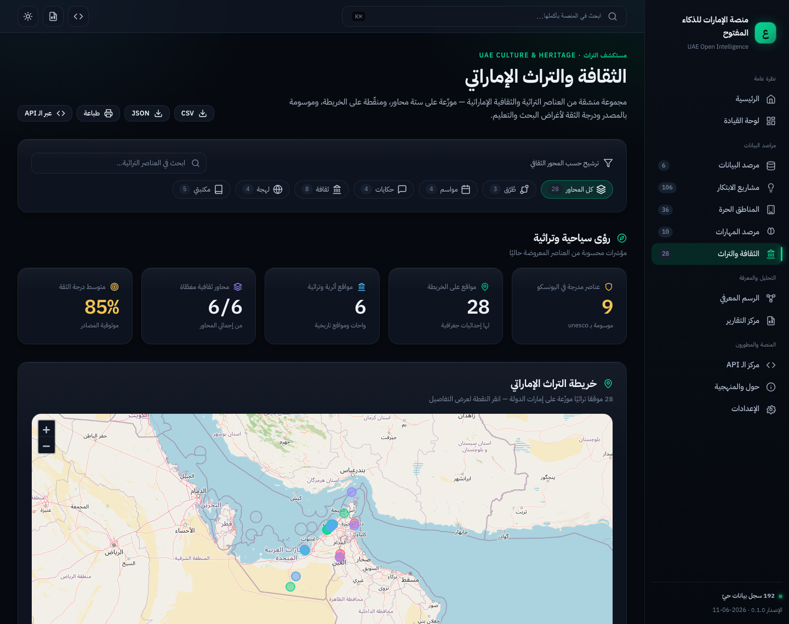
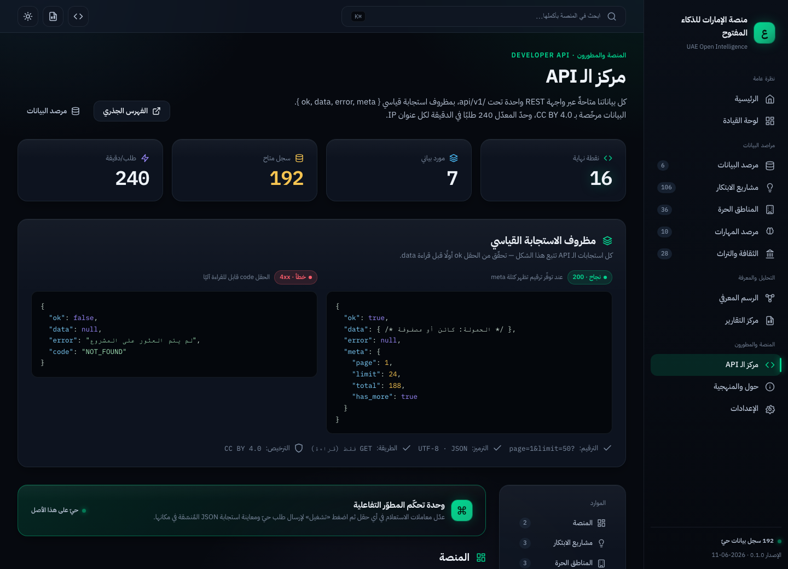

<div align="center">

# 🇦🇪 منصة الإمارات للذكاء المفتوح
### UAE Open Intelligence Platform

**مرصد بيانات · مركز تحليلات · API Hub · محرّك تقارير · قاعدة معرفة تفاعلية**

*An Arabic-first open-data intelligence platform that turns UAE public data into analytics, indicators, a knowledge graph and ready-to-use APIs.*

`Hono` · `TypeScript` · `HTMX` · `Alpine.js` · `Chart.js` · `Leaflet` · `SQLite (node:sqlite)` · no build step · no React


</div>

## 📸 Screenshots

| Landing | Dashboard | Knowledge Graph |
|---|---|---|
|  |  |  |

| Innovation detail (score radar) | Culture map | API Hub |
|---|---|---|
|  |  |  |

---

## ✨ ماذا تقدّم المنصة؟ / What it does

A self-hosted observatory unifying five UAE open-data domains into one operational, bilingual (RTL-native) intelligence surface:

| Domain | المحور | Records | Page |
|---|---|---|---|
| Innovation Projects | مشاريع الابتكار | **106** | `/innovation` |
| Free Zones | المناطق الحرة | **36** | `/free-zones` |
| AI Skills & Observatory | مهارات الذكاء الاصطناعي | **10 + KPIs** | `/skills` |
| Culture & Heritage | الثقافة والتراث | **28** | `/culture` |
| Macro Indicators | المؤشرات الكلية | **12** | `/dashboard` |
| Knowledge Graph | الرسم المعرفي | **209 nodes / 306 edges** | `/knowledge-graph` |

Plus a searchable **Data Observatory** (`/datasets`), a print/PDF **Reports Center** (`/reports`), an interactive **API Hub** (`/api-hub`), an executive **Dashboard** (`/dashboard`), and a global **command palette** (`⌘K`).

## 🚀 التشغيل / Quick start

```bash
npm install          # install deps (Hono, tsx, typescript — no native modules)
npm run build-db     # build data/uae.db from the committed data/export/*.json (self-contained)
npm run dev          # start dev server (watch)  → http://localhost:3000
# or
npm start            # start server
```

> Fresh clone? Use `npm run build-db` — it rebuilds the database from the committed JSON export and needs nothing else. `npm run seed` is the full pipeline that *regenerates* that export from the raw source datasets (only available in the original monorepo).

**Docker:** `docker build -t uae-oi . && docker run -p 3000:3000 uae-oi` (builds the DB from the export at image-build time).

Requirements: **Node ≥ 24** (uses the built-in `node:sqlite`). No compiler / native build needed.

### Scripts
| Script | Purpose |
|---|---|
| `npm run build-db` | Build `data/uae.db` from the committed `data/export/*.json` (self-contained) |
| `npm run seed` | Full pipeline: normalize raw source datasets → `data/uae.db` + `data/export/*.json` |
| `npm run dev` | Dev server with hot reload (`tsx watch`) |
| `npm start` | Run the server |
| `npm run typecheck` | TypeScript type-check (no emit) |
| `npm test` | Route smoke test |

## 🗺️ الصفحات / Pages

`/` · `/dashboard` · `/datasets` · `/datasets/:id` · `/free-zones` · `/free-zones/:id` · `/innovation` · `/innovation/:id` · `/skills` · `/culture` · `/knowledge-graph` · `/reports` · `/api-hub` · `/settings`

## 🔌 API

Standard REST under `/api/v1` with a unified `{ ok, data, error, meta }` envelope, pagination, filtering and a 240 req/min rate limit. Full reference: **[APIs.md](APIs.md)** — interactive explorer: **`/api-hub`**.

```bash
curl "http://localhost:3000/api/v1/projects?sector=health&sort=impact&limit=3"
curl "http://localhost:3000/api/v1/free-zones?emirate=Dubai&costBand=low"
curl "http://localhost:3000/api/v1/search?q=دبي"
```

## 🏗️ Architecture

Server-rendered Hono app (HTML template strings, no client framework). SQLite is the runtime store, seeded from the source JSON/CSV. A single bespoke design system (`public/static/app.css`) provides the dark, glass, RTL-native "mission-control" aesthetic. See **[docs/ARCHITECTURE.md](docs/ARCHITECTURE.md)**.

```
src/
  server.ts            Hono app: static, security headers, rate-limit, routes
  routes/api.ts        /api/v1/* JSON endpoints
  lib/                 db (data layer) · layout (shell) · ui · icons · i18n · api
  pages/               one module per page (returns LayoutOpts)
scripts/seed.ts        source data → SQLite + JSON exports
public/static/         app.css · app.js · vendored htmx/alpine/chart.js/leaflet
data/                  culture.seed.json (curated) · uae.db (generated) · export/
```

## 🎨 Design

Brutalist-operational + Apple/Linear/Stripe/Bloomberg fusion: dense, information-first, glass panels, layered depth, data-glow, gradient mesh, RTL-native Arabic typography (IBM Plex Sans Arabic / Tajawal), dark + light themes, print-ready reports, WCAG-minded contrast and focus states.

## 📊 Data & confidence

Every dataset is labelled with **source**, **vintage** and a **confidence score** (0–1). Figures marked prototype/approx are source-labelled. Curated heritage content draws on UNESCO ICH/WHS and DCT references. **Always verify critical figures against official sources** (u.ae, FCSC, Ministry of Economy, free-zone authorities).

## 🚀 Deployment

Single Node process, no native deps, no build step — the DB is rebuilt from the committed JSON export at deploy time. Bare-metal, Docker, and Coolify/Proxmox paths are in **[DEPLOYMENT.md](DEPLOYMENT.md)**.

```bash
docker build -t uae-oi . && docker run -d -p 3000:3000 uae-oi
```

## 🗺️ Roadmap

Current release is **v0.1.0 (public preview)**. See **[ROADMAP.md](ROADMAP.md)** for what's next (depth & coverage → AI assistant layer → contribution workflow).

## ⚠️ Known limitations

- **Prototype indicators.** The AI-adoption observatory figures (adoption-by-function, skills demand) are illustrative prototype values — clearly labelled in-app; verify before citing.
- **Free-zone costs are indicative.** First-year costs are compiled from publicly advertised 2024–2025 packages and change frequently; confirm with the zone authority.
- **Curated heritage set.** The 28 culture items are a curated educational sample with approximate map coordinates, not an exhaustive registry.
- **Auto sector classification.** Project sectors are assigned by Arabic keyword rules — a small number may be cross-sector judgement calls.
- **In-memory rate limiter** is per-instance (not shared across replicas).
- **No Sankey/treemap** yet (Chart.js has no native support) — radar, heatmap, geo-map and the force-graph cover relational/density views for now.
- Data is a point-in-time snapshot; there is no historical/time-series layer yet.

## 📜 License

- **Code:** MIT — see [LICENSE](LICENSE)
- **Data:** CC BY 4.0 — aggregated/curated from public sources for research & education.

## 🤝 Contributing

See [CONTRIBUTING.md](CONTRIBUTING.md), [ROADMAP.md](ROADMAP.md), [CHANGELOG.md](CHANGELOG.md), and [docs/ARCHITECTURE.md](docs/ARCHITECTURE.md).
